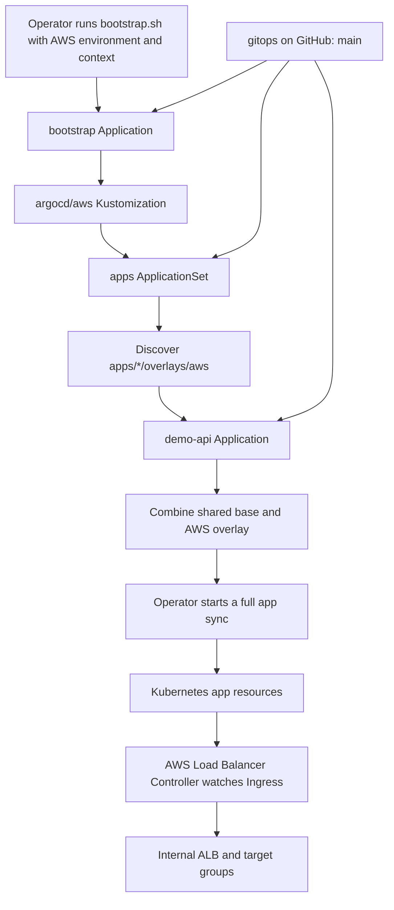
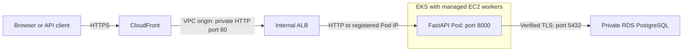

# How this repository works

`gitops` describes how to run containerised applications on an existing AWS
Kubernetes platform. It currently deploys one FastAPI service, `demo-api`,
with a private PostgreSQL database and public HTTPS access through CloudFront.

The deployment model is **GitOps**: Git holds the desired Kubernetes
configuration, and Argo CD reads that configuration to apply it to the cluster.
This guide explains the checked-in configuration and the architecture recorded
in the runbooks; it is not a live AWS inventory.

## The repositories and their responsibilities

The project separates application development, infrastructure and deployment.
Both infrastructure targets below belong to the same `infra` repository:

| Repository or target directory | Responsibility | Produces or manages |
| --- | --- | --- |
| `demo-api` | Application development | API code, Dockerfile, Alembic database migrations and release images published to GitHub Container Registry (GHCR) |
| `infra/environments/aws/dev` | AWS platform provisioning through Terraform | Network, EKS cluster and managed EC2 workers, private RDS PostgreSQL, security groups, Argo CD/controller installations, CloudFront and access-log storage |
| **`gitops`** | Application deployment on that platform | Kubernetes manifests, Argo CD registrations, release image selection, credential helpers and operational guides |
| `infra/environments/local` | Local platform provisioning | kind, shared Traefik, Argo CD and separate Compose PostgreSQL; local app manifests use this GitOps repository’s local overlay |

There are two ownership boundaries within AWS as well. Argo CD manages the
application's Kubernetes resources. The **AWS Load Balancer Controller** watches
its Ingress and creates the ALB and target groups. Terraform supplies the ALB's
frontend security group and later references the ALB for CloudFront; it does not
also manage that controller-created ALB.

See the [infrastructure contract](infrastructure.md) for the full handoff.

## How deployment configuration reaches the cluster

The registration chain starts at [bootstrap/aws.yaml](../../bootstrap/aws.yaml). It defines
the `bootstrap` Argo CD Application on EKS, which reads `argocd/aws/` from GitHub `main`.
The bootstrap Application automatically syncs registrations and corrects drift in them.

[argocd/aws/apps.yaml](../../argocd/aws/apps.yaml) defines an **ApplicationSet**, a template
that discovers each `apps/*/overlays/aws` directory on `main`. For each
entry it extracts the app name from path segment 1 and generates an Argo CD
Application named `<app>` targeting namespace `<app>`. Today this produces `demo-api` in the Argo CD
namespace, deploying workloads into namespace `demo-api`.

Each generated Application points at its AWS overlay's **Kustomization**, which
combines `../../base` with AWS configuration and supplies the release image tag. App syncs are manual in
the checked-in template. Publishing a commit makes it available to Argo CD;
an operator reviews the diff and starts the app sync.

[scripts/bootstrap.sh](../../scripts/bootstrap.sh), using
`--environment aws --context CONTEXT`, validates the manifests,
checks the existing platform components and registers `bootstrap`. It requires an
explicit Kubernetes context. It does not provision the platform or start the
app's manual sync. Argo CD reads the published `main` branch, so local edits must
be pushed before they can be deployed.

## What is deployed for demo-api

The entry point is
[apps/demo-api/overlays/aws/kustomization.yaml](../../apps/demo-api/overlays/aws/kustomization.yaml).
It selects image `ghcr.io/pquarg/demo-api:0.1.13` for both the API and its
migration Job.

| Resource | Purpose |
| --- | --- |
| Deployment | Runs one API replica on port `8000`, with health probes, resource limits and a non-root container security context |
| ClusterIP Service | Gives the API a stable in-cluster endpoint on port `80`, selecting Pods by their labels |
| Ingress | Declares routing to that Service and asks the ALB controller for an internal ALB with Pod IP targets |
| Migration Job | Runs `python -m alembic upgrade head` from the same release image as the API |
| App ConfigMap | Supplies the non-secret `APP_MESSAGE` setting |
| Generated CA ConfigMap | Mounts the committed public RDS certificate bundle for verified database TLS; its content hash changes when the bundle changes |

Credentials are provisioned separately. Both workloads read `AUTH_DATABASE_URL`
from `demo-api-secrets` and pull their image using `registry-credentials`.
The filled Secrets are outside Kustomize and Git. The repository contains only
an empty database Secret example and the public CA certificates.

### Migration and rollout order

Argo CD sync waves enforce this sequence during a full app sync:

1. **Wave 0:** apply ConfigMaps and Service, and run the migration hook against RDS.
2. **Wave 1:** roll out the API Deployment after the migration succeeds.
3. **Wave 2:** apply the Ingress after the Deployment becomes healthy.

The migration is a `Sync` hook, so it runs on later full syncs too. The previous
Job is replaced before the next hook run. A failed migration blocks the rollout;
a selective resource sync skips hooks and must not be used for app releases.

Existing Pods can still serve requests while migrations run. Schema changes
therefore need to support the running release or use planned maintenance.
Reverting the image tag in Git does not undo a database migration.

## How a request reaches the application

The Ingress references the ClusterIP Service to identify the backend. Because
the ALB uses `target-type: ip`, actual ALB traffic goes to registered Pod IPs on
port `8000`. The Service is also available for in-cluster access and operator
port forwarding.

Public HTTPS terminates at CloudFront using its AWS-provided hostname and
certificate. The origin connection uses HTTP inside the private network. The
internal ALB's frontend security group permits CloudFront origin-facing traffic;
the controller manages backend access rules. The database has no public endpoint,
and both the API and migration Job verify its TLS certificate and hostname using
the mounted CA bundle.

The [public-access runbook](public-access.md) records disabled API caching,
security/no-store response headers, HTTPS redirect handling and private S3
access-log delivery managed through `infra/environments/aws/dev/edge`. The same ignored
operator allowlist supplies foundation's API restrictions and edge's viewer
function. Configuration does not prove the live restriction is active; verify
both allowed and denied networks after reviewing/applying both owning stages.

`/health` is the API liveness check. `/ready` checks database connectivity and
is used by Kubernetes readiness and ALB target health checks. These checks serve
different purposes from Argo CD's configuration sync status.

## The normal deployment lifecycle

The first deployment has a dependency order:

1. Apply `infra/environments/aws/dev/foundation` for network/EKS/RDS/controller IAM and
   frontend SG/rules, then `terraform/platform` for the two Helm releases.
2. Provision Git access, the app database login/connection Secret and the GHCR
   pull Secret. Set the Ingress security-group ID from the infrastructure output.
3. Validate and publish the manifests, bootstrap the registration, then
   review and manually sync the entire app.
4. Wait for the internal ALB and healthy targets, then provision its CloudFront
   VPC origin and distribution through `infra/environments/aws/dev`.
5. Verify the public endpoint, authentication and access-log delivery.

CloudFront comes after the app sync because its VPC origin references the ALB
created from the app's Ingress. The complete commands are in
[deploy from scratch](deploy-from-scratch.md).

For a later release, publish a new image from the application repository, update
`images[].newTag` in the app's Kustomization, validate and push, then perform a
full manual sync and verify the result. One tag change updates both workloads.
The [app runbook](../../apps/demo-api/overlays/aws/README.md) covers releases and recovery.

## Supporting scripts and checks

| Entry point | Role |
| --- | --- |
| `scripts/validate.sh` | Checks Bash syntax and app naming, renders Kustomizations and validates Kubernetes/Argo CD schemas; `--no-placeholders` also rejects placeholders |
| `scripts/validate-server.sh` | Optionally checks rendered resources against the cluster API with server dry-run; requires an app name and explicit context |
| `scripts/bootstrap-demo-api-rds.py` | Initialises this project's restricted app database login and connection Secret using a temporary in-cluster PostgreSQL client; verifies TLS and permissions without running Alembic |
| `scripts/configure-ghcr-credentials.py` | Prompts for a GHCR package-read token and applies the namespace's image-pull Secret |
| `scripts/image-pull-check.yaml` | Tests pulling the private app image without starting the API or running migrations |
| `scripts/check-public-endpoint.py` | Checks public health, docs, redirects, headers and unauthenticated access; `--auth` also creates a synthetic account and tests login/logout/revocation |
| `.github/workflows/validate.yaml` | Runs manifest validation on pushes, pull requests and manual dispatch using pinned validation tools |

CI validates deployment configuration; app images are built elsewhere and app
sync remains manual. Local validation does not prove that AWS resources,
credentials or runtime connectivity work. The optional authentication check
leaves its synthetic account behind after revoking the test session.

## Extending and retiring the deployment

To add a service, create `apps/<name>/base/` and `overlays/aws/` Kustomizations, provision its
dependencies and credentials, and publish it. The ApplicationSet discovers it
without a separate registration entry. Follow [adding apps](adding-apps.md) for
the naming rules and per-app ALB pattern.

Removing an app directory does not clean up the environment. The ApplicationSet
uses `preserveResourcesOnDeletion: true`, and AWS dependencies have separate
owners. Keep the cluster and controller running until controller-owned load
balancers are removed. Follow [teardown](teardown.md) for dependency order and
backup/log retention choices.

For day-to-day navigation, use [setup](setup.md), [credentials](credentials.md)
and [validation](validation.md).
